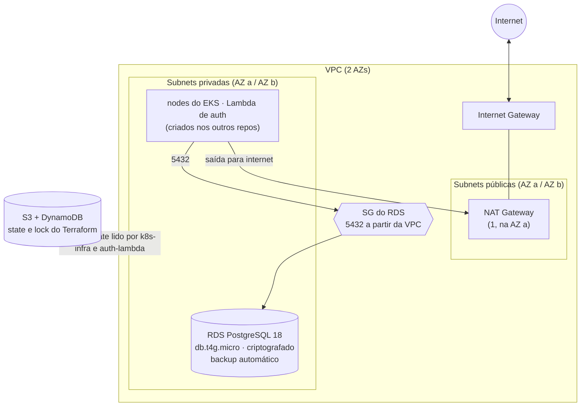

# tech-challenge-db-infra

Terraform da rede e do PostgreSQL gerenciado (RDS) usados pela oficina na nuvem.

O que sobe aqui:

- VPC com subnets públicas e privadas
- RDS PostgreSQL (hoje na 18.6)
- Security group na porta 5432
- Outputs para o cluster EKS e para a aplicação (endpoint, JDBC, IDs de rede)



O EKS fica no repositório [tech-challenge-k8s-infra](https://github.com/fiap-pos-2026/tech-challenge-k8s-infra). A aplicação está em [tech-challenge-core](https://github.com/fiap-pos-2026/tech-challenge-core).

Decisões relacionadas: [RFC-001 — nuvem AWS](https://github.com/fiap-pos-2026/tech-challenge-core/blob/main/docs/arquitetura/rfc/RFC-001-nuvem-aws.md), [ADR-006 — RDS PostgreSQL](https://github.com/fiap-pos-2026/tech-challenge-core/blob/main/docs/arquitetura/adr/ADR-006-banco-gerenciado-rds.md), [ADR-001 — quatro repositórios](https://github.com/fiap-pos-2026/tech-challenge-core/blob/main/docs/arquitetura/adr/ADR-001-quatro-repositorios.md). Índice completo em [`docs/arquitetura`](https://github.com/fiap-pos-2026/tech-challenge-core/blob/main/docs/arquitetura/README.md) no core.

## Stack

| Item | Valor |
|---|---|
| Nuvem | AWS (`us-east-1` no lab da FIAP) |
| Banco | RDS PostgreSQL 18.6 |
| IaC | Terraform ≥ 1.6 |
| State | S3 + DynamoDB (lock) |

No lab da academia, o login via OIDC no GitHub Actions não funciona. Usamos as chaves temporárias do **Start Lab** (incluindo `AWS_SESSION_TOKEN`) e renovamos a cada sessão.

## Outputs

Este repositório é público. Por isso **não** colocamos endpoints, IDs de VPC/subnet/SG nem senha no README.

Depois do apply:

```bash
terraform output
```

No GitHub Actions, os mesmos valores aparecem no final do job de apply. JDBC, usuário e senha do banco vão para o time só por canal privado.

## Como rodar local

1. Lab ligado e CLI configurada.
2. Copie os exemplos e preencha bucket, tabela de lock e senha do banco:

```bash
cp terraform.tfvars.example terraform.tfvars
cp backend.hcl.example backend.hcl
terraform init -backend-config=backend.hcl
terraform plan -var-file=terraform.tfvars
terraform apply -var-file=terraform.tfvars
```

Não commite `terraform.tfvars`, `backend.hcl` nem arquivos de state.

## CI

PR em `main`: fmt, validate e plan.  
Push em `main`: apply no environment `homolog`.

Secrets no repositório (só no GitHub, nunca no código): access key, secret, session token, bucket, tabela de lock e `TF_VAR_DB_PASSWORD`.

## Custo

O que mais pesa aqui é o **NAT Gateway**, além do RDS. Se ninguém for usar o ambiente, faça `terraform destroy`. No lab, olhe o crédito restante no portal antes de deixar tudo ligado overnight.
